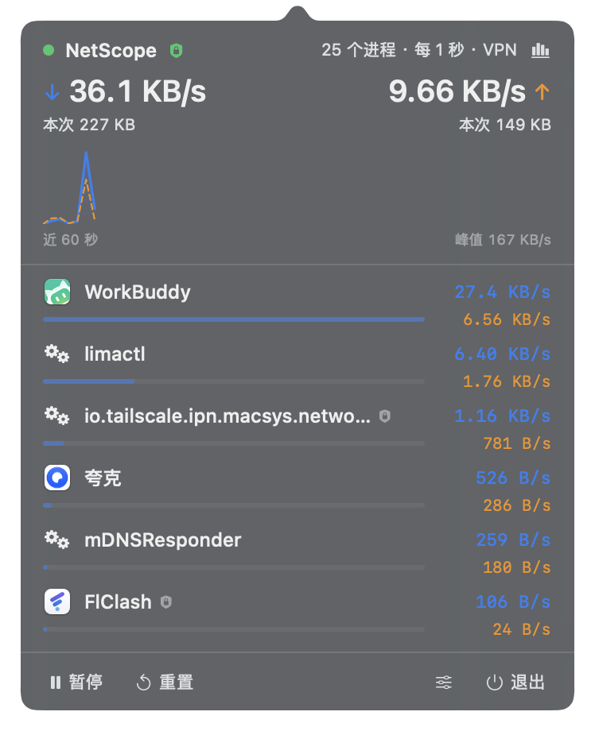

# NetScope

macOS 菜单栏常驻的**应用级网络流量监控**。SwiftUI 原生，约 670 KB 可执行文件，无 root 权限、
无内核扩展、无系统扩展、零第三方依赖。



菜单栏默认形态：


## 功能

- **每秒采样**：按进程统计上下行字节，自动归并同一应用的多个进程
  （`Google Chrome Helper (Renderer)` 会算进 `Google Chrome`）
- **菜单栏双行数值**：网络图标 + 两行实时速率（上行在上、下行在下），右键可切成 40 点趋势图
- **弹出面板**：总下行 / 上行速率、本次会话累计、近 60 秒双向曲线、按占用排序的应用列表
- **历史统计**：按天写入 SQLite，可看今日 / 近 7 天用量、7 天柱状图、今日 Top 应用
- **流量告警**：某个应用连续 3 秒超过阈值时发系统通知（同应用 10 分钟内只提醒一次）
- **列表口径**（可选）：只统计物理链路，此时各应用之和与总量一致
- **右键菜单**：暂停监控、显示速率开关、退出
- **面板内设置**：刷新间隔、显示条数、列表口径、告警、开机启动

## 使用

| 操作 | 效果 |
|---|---|
| 左键点菜单栏图标 | 打开 / 关闭面板 |
| 右键点菜单栏图标 | 暂停监控、切换趋势图、退出 |
| 面板右上角图标 | 切换「实时速率」/「历史用量」 |
| 面板底部 `⏸` / `↺` | 暂停采样 / 清空本次累计与曲线（不清历史） |
| 面板底部 `≡` | 展开设置 |
| 退出 | 会 flush 历史并把 nettop 子进程一并回收 |

把 `NetScope.app` 拖进「应用程序」后，才能用「开机自动启动」（`SMAppService` 要求 app 位于
可注册位置，放在项目目录里注册会失败并自动回滚开关）。

## 历史与统计

数据落在 `~/Library/Application Support/NetScope/traffic.db`（SQLite，系统自带库）。
表结构只有一张：

```sql
daily_app_traffic(day TEXT, app_key TEXT, app_name TEXT, bytes_in INTEGER, bytes_out INTEGER)
```

- **写入节流 30 秒**：采样是每秒一次，但落盘每 30 秒一次。逐秒 UPSERT 会把磁盘写入放大 30 倍，
  而这份数据的粒度本来就只是「天」—— 崩溃最多丢 30 秒。
- **按天聚合**：跨天自动分桶，保留 120 天。
- **口径与列表一致**（external）：历史里的「Top 应用」和实时面板看到的是同一套数字。

清空历史：

```bash
rm -rf ~/Library/Application\ Support/NetScope    # 退出应用后执行
```

## 流量告警

在设置里打开「流量告警」，选择阈值（1 / 5 / 10 / 20 MB/s）。首次开启会请求通知权限。

规则刻意保守，否则这个功能会变成噪音：

- **连续 3 次采样都超阈值**才算：下载刚开始那一秒的瞬时峰值不算。
- **同应用 10 分钟冷却**：不会连续轰炸。
- **掉到阈值以下即清零**：不会把隔了很久的几次命中算成"连续"。

## 构建

```bash
bash Scripts/build_app.sh            # 编译 → 生成图标 → 组装 .app → 签名 → 启动
bash Scripts/build_app.sh --no-open  # 同上但不启动
bash Scripts/build_app.sh --dmg      # 额外产出 DMG

bash Scripts/selfcheck/run.sh        # 纯逻辑自检（59 项断言，含真实 pty 采样）
```

无界面自检与界面快照（不依赖屏幕录制 / 辅助功能权限）：

```bash
BIN=dist/NetScope.app/Contents/MacOS/NetScope
"$BIN" --headless                              # 采样 8 次后打印统计，退出码 0 = 通过
"$BIN" --headless --demo --render-panel /tmp/p.png   # 用合成数据渲染完整面板（浅色+深色两张）
"$BIN" --show-panel                            # 启动后自动弹面板，并打印窗口号供 screencapture -l
```

## 原理

数据来自系统自带的 `nettop`：

```
nettop -P -x -L 0 -s 1 -J bytes_in,bytes_out -t external
```

三个关键约束决定了实现方式（都是实测结论）：

1. **`nettop -L N` 的采样窗口固定 30 秒**，与 `N`、`-s` 无关。想每秒取一次不能靠反复启动子进程。
2. **`-L 0` 接管道时 stdout 是全缓冲**（4 KB 才刷一次），实测数秒延迟，进程被杀时缓冲区还会丢光。
   解决办法是给它一个 pty：收到 pty 后 nettop 变成行缓冲，输出即时可读且仍是纯文本 CSV
   （不会切到 curses 全屏界面）。
3. **输出的字节数是「进程自启动以来的累计值」**，所以速率必须靠两次采样差分。差分时保留
   30 秒基准，让「这秒有连接、下秒没有」的进程重新出现后仍能算对——否则那段字节会凭空消失。

进程名一律用 `pid` 反查：nettop 自带的名字被截断到约 10 个字符（`哔哩哔哩 He.32520`）。
`NSWorkspace.runningApplications` 只覆盖有 UI 的应用（Helper 进程的 activationPolicy 是
`.prohibited`，不在其中），所以再沿 `proc_pidpath` 向上找**最外层** `.app`，才能把 Helper 归并到宿主应用。

## VPN 与虚拟接口：总量只认物理网卡

nettop 是**按 socket 所在接口**归因的。开着 TUN 型 VPN 时，同一份数据会出现两次：

```
Safari 的 socket ──► utun6（明文）──────────────► 计给 Safari
                          │
                          └─► FlClash 加密 ──► en0（密文）──► 计给 FlClash
```

两者相加，总量就翻倍。虚拟机（Lima / Docker）的虚拟接口同理。实测同一次采样：

| 范围 | 1 秒合计 | 主要构成 |
|---|---|---|
| `-t external`（含 utun / bridge / vmnet） | 23,575 B | limactl 6478、tailscale 6078、syspolicyd 4417 |
| `-t wifi -t wired`（只有 en\*） | 10,758 B | 同上，但在物理接口上的部分 |

因此工具跑**两条采样通道**：

| 通道 | 参数 | 用途 |
|---|---|---|
| 应用列表 | `-t external` | 覆盖所有应用，包括走隧道的那部分 |
| **总量** | `-t wifi -t wired` | **只算网卡真实跑过的字节，不会重复** |

VPN 应用**不剔除**：它显示的流量就是物理链路上的真实字节，删掉等于漏统计。
代价是「VPN 客户端的密文」与「隧道内应用的明文」互为副本，各应用之和会大于总量。
这类行在名称后带一个盾牌标记，悬停有说明。

标题旁的盾牌图标 + 状态栏里的「VPN」表示当前检测到活动隧道，判据是 `utun*` 上分配了
IPv4 地址——macOS 会给每个 utun 都发 `fe80::`（utun0–4 这类内部接口就是这样），
用 IPv4 能干净地区分。纯代理模式（非 TUN）不会触发该标记，那时流量只经过物理链路一次。

## 已知限制

- 只统计 TCP / UDP socket。ICMP、部分 RAW socket 不计入。
- 用 `-t external` 排除了 loopback，`127.0.0.1` 上的通信不显示。
- 走 TUN 型 VPN 时，列表里 VPN 应用与隧道内应用互为副本，各应用之和会大于总量；
  总量本身不受影响（取自物理网卡）。
- 依赖 `/usr/bin/nettop`（系统自带，不随移除）。
- 临时签名（`codesign --sign -`），仅本机可运行；拷给别人会被 Gatekeeper 拦下。

## 目录

```
Sources/NetScope/
├── Core/                     # 不依赖 AppKit，可脱离 GUI 单独编译测试
│   ├── ProcCounters.swift        nettop CSV 解析
│   ├── TrafficAggregator.swift   累计值差分、应用聚合、速率历史
│   ├── TrafficChannel.swift      一条通道 = 采样器 + 差分器
│   ├── NettopPTY.swift           pty + posix_spawn，实时读取
│   ├── TunnelDetector.swift      VPN 隧道/客户端识别
│   ├── HistoryStore.swift        SQLite 按天持久化
│   ├── AlertCenter.swift         阈值告警（连续命中 + 冷却）
│   ├── ProcessDirectory.swift    pid → 名称/图标/聚合键
│   └── OrphanReaper.swift        清理异常退出遗留的 nettop
├── App/                      # 生命周期、菜单栏、引擎、偏好
├── Views/                    # 面板、迷你曲线、应用行、历史视图
└── Support/                  # 格式化、配色、菜单栏趋势图绘制
Scripts/
├── build_app.sh              组装 .app
├── make_icon.swift           自绘 iconset（不依赖外部图形工具）
├── cpumeter.swift            用 libproc 读 CPU/内存（沙箱里 top 不可用时）
├── traffic-probe.sh          双通道并行对比，验证去重前提
└── selfcheck/                104 项断言 + 真实 pty 端到端
```

详见 [HANDOVER.md](HANDOVER.md)。
