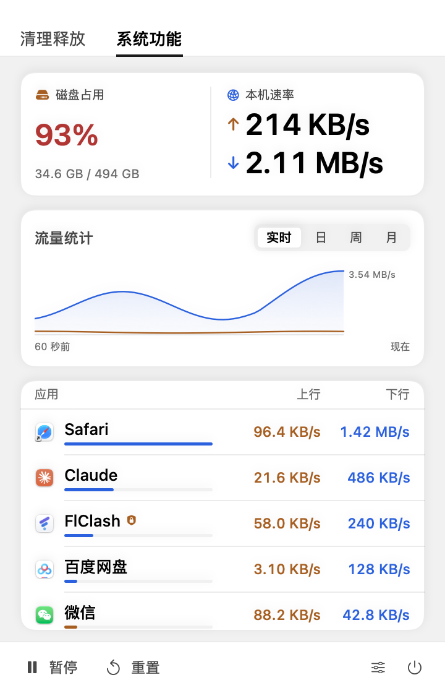
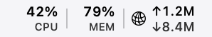

# NetScope

> 官网 <https://zdx8.github.io/NetScope-macOS/> · 下载 [Releases](https://github.com/zdx8/NetScope-macOS/releases/latest)

macOS 菜单栏常驻的**应用级网络流量监控**。SwiftUI 原生，约 1.9 MB 可执行文件，无 root 权限、
无内核扩展、无系统扩展、零第三方依赖。



菜单栏只占一项，内部三段用竖线分隔（顺序从左到右：CPU · 内存 · 网络），点哪段弹哪段：



## 功能

- **每秒采样**：按进程统计上下行字节，自动归并同一应用的多个进程
  （`Google Chrome Helper (Renderer)` 会算进 `Google Chrome`）
- **菜单栏一项三段**：`42% CPU │ 79% MEM │ 🌐 ↑1.2M ↓8.4M`，竖线分隔、整块约 129pt；
  点某一段就弹那一段的详情（按下当刻记录光标位置并用徽标矩形校验，重放的幽灵点击直接丢弃）。
  三段可单独关闭，网络段可切成 40 点趋势图
- **清理释放页**：CPU 与内存双卡并排，两条曲线叠在同一 0–100% 刻度上；
  程序列表带「按 CPU / 按内存」两档排序，鼠标悬停行尾出现「关闭」，点一下就结束该应用
- **系统功能页**：磁盘占用（含可用空间）与本机速率（上行在上、下行在下），
  样式对齐清理释放页的指标卡；下方按流量排序的应用列表
- **流量统计四档**：实时（60 秒速率曲线）/ 日（过去 24 小时，5 分钟平均值，288 点）/
  周（过去 7 天，30 分钟平均值，336 点）/ 月（过去 30 天，2 小时平均值，360 点），
  下行蓝、上行橙双线自动定标；图表与下方应用列表**同步换档**——历史档显示该时间段每应用的累计流量排行
- **面板主题**：设置里可切「跟随系统 / 浅色 / 深色」，只影响弹出面板；
  菜单栏徽标跟随系统菜单栏的深浅
- **分层时间桶持久化**：增量先落 5 分钟桶（保留 26h），落盘时自动聚合出 30 分钟桶（8.5 天）
  与 2 小时桶（31.5 天），覆盖写不翻倍；数据按天累积，装得越久月视图越有看头
- **Astryx 设计系统**：颜色、字号、4pt 间距、圆角、阴影全部按 meta/astryx 的 `neutral` 主题令牌实现，
  面板是固定尺寸 360×560，切换清理释放/系统功能/设置时窗口不跳动
- **流量告警**：某个应用连续 3 秒超过阈值时发系统通知（同应用 10 分钟内只提醒一次）
- **列表口径**（可选）：只统计物理链路，此时各应用之和与总量一致
- **右键菜单**：三段显示开关、暂停监控、网络图标形态、退出
- **面板内设置**：三段开关、网络图标形态、刷新间隔、显示条数、列表口径、告警、开机启动

## 使用

| 操作 | 效果 |
|---|---|
| 左键点 `42% CPU` 那一段 | 打开清理释放页，程序列表按 CPU 排序 |
| 左键点 `79% MEM` 那一段 | 打开清理释放页，程序列表按内存占用排序 |
| 左键点 `🌐 ↑↓` 那一段 | 打开系统功能页（磁盘/速率统计 + 流量统计 + 应用列表） |
| 面板开着时再点菜单栏项 | 收起面板（不区分段；点面板外或按 Esc 也会收起） |
| 右键点菜单栏项（任一段） | 三段显示开关、暂停监控、网络图标形态、退出 |
| 面板顶部选项栏 | 切换「清理释放」/「系统功能」 |
| 流量统计卡的 实时/日/周/月 | 切换图表与下方应用排行的数据源（实时=速率，日/周/月=区间累计） |
| 面板底部 `⏸` / `↺` | 暂停采样 / 清空本次累计与曲线（不清历史） |
| 面板底部 `≡` | 展开设置 |
| 退出 | 会 flush 历史并把 nettop 子进程一并回收 |

把 `NetScope.app` 拖进「应用程序」后，才能用「开机自动启动」（`SMAppService` 要求 app 位于
可注册位置，放在项目目录里注册会失败并自动回滚开关）。

## 历史与统计

数据落在 `~/Library/Application Support/NetScope/traffic.db`（SQLite，系统自带库），
一张分层表 `traffic_samples`，三档粒度彼此整除：

| 粒度 | 桶宽 | 保留期 | 用在哪 |
|---|---|---|---|
| 5 分钟 | 300s | 26 小时 | 日图表（288 点）、历史档应用排行 |
| 30 分钟 | 1800s | 8.5 天 | 周图表（336 点） |
| 2 小时 | 7200s | 31.5 天 | 月图表（360 点） |

- **写入节流 30 秒**：采样每秒一次，落盘每 30 秒一次；增量在内存里先归并进当前 5 分钟桶
- **聚合是覆盖写**：每次落盘顺带把受影响的父桶 DELETE 后从 5 分钟源桶重新 SUM——
  父桶会被反复重算，累加 UPSERT 会把旧值越加越大
- **查询很轻**：周视图只扫 336 个 30 分钟桶、月视图只扫 360 个 2 小时桶，不碰原始层
- 自检覆盖：桶对齐、同桶累加、跨桶独立、覆盖写不翻倍、series 补 0、topApps 排序与起点过滤、
  超保留期清理（共 214 项断言的一部分）

清空历史：

```bash
rm -rf ~/Library/Application\ Support/NetScope    # 退出应用后执行
```

## 流量告警

在设置里打开「流量告警」，选择阈值（1 / 5 / 10 / 20 MB/s）。首次开启会请求通知权限。

规则刻意保守，否则这个功能会变成噪音：

- **连续 3 次采样都超阈值**才算：下载刚开始那一秒的瞬时峰值不算。
- **同应用 10 分钟冷却**：不会连续轰炸。
- **掉到阈值以下即清零**：不会把隔了很久的几次命中算成"连续"。

## 构建

```bash
bash Scripts/build_app.sh            # 编译 → 生成图标 → 组装 .app → 签名 → 启动
bash Scripts/build_app.sh --no-open  # 同上但不启动
bash Scripts/build_app.sh --dmg      # 额外产出 DMG

bash Scripts/selfcheck/run.sh        # 纯逻辑自检（214 项断言，含真实 pty 与 libproc 采样）
```

无界面自检与界面快照（不依赖屏幕录制 / 辅助功能权限）：

```bash
BIN=dist/NetScope.app/Contents/MacOS/NetScope
"$BIN" --headless                              # 采样 8 次后打印统计，退出码 0 = 通过
"$BIN" --headless --demo --render-panel /tmp/p.png   # 用合成数据渲染系统功能页（浅色+深色两张）
"$BIN" --headless --demo --render-panel /tmp/p.png --panel-mode settings   # 设置页
"$BIN" --headless --demo --render-load /tmp/p.png    # 清理释放页（按 CPU / 按内存各两张）
"$BIN" --headless --demo --render-badges /tmp/b.png  # 菜单栏徽标对照图
"$BIN" --show-panel                            # 启动后自动弹面板，并打印窗口号供 screencapture -l
```

## 原理

数据来自系统自带的 `nettop`：

```
nettop -P -x -L 0 -s 1 -J bytes_in,bytes_out -t external
```

三个关键约束决定了实现方式（都是实测结论）：

1. **`nettop -L N` 的采样窗口固定 30 秒**，与 `N`、`-s` 无关。想每秒取一次不能靠反复启动子进程。
2. **`-L 0` 接管道时 stdout 是全缓冲**（4 KB 才刷一次），实测数秒延迟，进程被杀时缓冲区还会丢光。
   解决办法是给它一个 pty：收到 pty 后 nettop 变成行缓冲，输出即时可读且仍是纯文本 CSV
   （不会切到 curses 全屏界面）。
3. **输出的字节数是「进程自启动以来的累计值」**，所以速率必须靠两次采样差分。差分时保留
   30 秒基准，让「这秒有连接、下秒没有」的进程重新出现后仍能算对——否则那段字节会凭空消失。

进程名一律用 `pid` 反查：nettop 自带的名字被截断到约 10 个字符（`哔哩哔哩 He.32520`）。
`NSWorkspace.runningApplications` 只覆盖有 UI 的应用（Helper 进程的 activationPolicy 是
`.prohibited`，不在其中），所以再沿 `proc_pidpath` 向上找**最外层** `.app`，才能把 Helper 归并到宿主应用。

## VPN 与虚拟接口：总量只认物理网卡

nettop 是**按 socket 所在接口**归因的。开着 TUN 型 VPN 时，同一份数据会出现两次：

```
Safari 的 socket ──► utun6（明文）──────────────► 计给 Safari
                          │
                          └─► FlClash 加密 ──► en0（密文）──► 计给 FlClash
```

两者相加，总量就翻倍。虚拟机（Lima / Docker）的虚拟接口同理。实测同一次采样：

| 范围 | 1 秒合计 | 主要构成 |
|---|---|---|
| `-t external`（含 utun / bridge / vmnet） | 23,575 B | limactl 6478、tailscale 6078、syspolicyd 4417 |
| `-t wifi -t wired`（只有 en\*） | 10,758 B | 同上，但在物理接口上的部分 |

因此工具跑**两条采样通道**：

| 通道 | 参数 | 用途 |
|---|---|---|
| 应用列表 | `-t external` | 覆盖所有应用，包括走隧道的那部分 |
| **总量** | `-t wifi -t wired` | **只算网卡真实跑过的字节，不会重复** |

VPN 应用**不剔除**：它显示的流量就是物理链路上的真实字节，删掉等于漏统计。
代价是「VPN 客户端的密文」与「隧道内应用的明文」互为副本，各应用之和会大于总量。
这类行在名称后带一个盾牌标记，悬停有说明。

标题旁的盾牌图标 + 状态栏里的「VPN」表示当前检测到活动隧道，判据是 `utun*` 上分配了
IPv4 地址——macOS 会给每个 utun 都发 `fe80::`（utun0–4 这类内部接口就是这样），
用 IPv4 能干净地区分。纯代理模式（非 TUN）不会触发该标记，那时流量只经过物理链路一次。

## 已知限制

- 只统计 TCP / UDP socket。ICMP、部分 RAW socket 不计入。
- 用 `-t external` 排除了 loopback，`127.0.0.1` 上的通信不显示。
- 走 TUN 型 VPN 时，列表里 VPN 应用与隧道内应用互为副本，各应用之和会大于总量；
  总量本身不受影响（取自物理网卡）。
- CPU 温度与风扇转速读不了：AppleSMC 的键在无特权进程下全部返回「不可读」，
  面板不放拿不到的数值，该格用于磁盘占用与网络状态。
- 依赖 `/usr/bin/nettop`（系统自带，不随移除）。
- 临时签名（`codesign --sign -`），仅本机可运行；拷给别人会被 Gatekeeper 拦下。

## 目录

```
Sources/NetScope/
├── Core/                     # 不依赖 AppKit，可脱离 GUI 单独编译测试
│   ├── ProcCounters.swift        nettop CSV 解析
│   ├── TrafficAggregator.swift   累计值差分、应用聚合、速率历史
│   ├── TrafficChannel.swift      一条通道 = 采样器 + 差分器
│   ├── NettopPTY.swift           pty + posix_spawn，实时读取
│   ├── TunnelDetector.swift      VPN 隧道/客户端识别
│   ├── HistoryStore.swift        SQLite 按天持久化
│   ├── TrafficRange.swift        流量统计四档定义（实时/日/周/月 → 粒度映射）
│   ├── AlertCenter.swift         阈值告警（连续命中 + 冷却）
│   ├── ProcessDirectory.swift    pid → 名称/图标/聚合键
│   ├── SystemLoadProbe.swift     Mach 接口读系统 CPU / 内存
│   ├── ProcessLoadProbe.swift    libproc 读每进程 CPU 时间与 phys_footprint
│   ├── SystemStatsProbe.swift    磁盘容量 / 散热档位 / 开机时长（statfs，无特权）
│   ├── ProcessMetric.swift       程序列表排序维度（按 CPU / 按内存）
│   └── OrphanReaper.swift        清理异常退出遗留的 nettop
├── App/                      # 生命周期、菜单栏、引擎、偏好、页面路由
├── Views/                    # 面板、双指标卡、程序列表、应用行、系统区块
└── Support/                  # 格式化、Astryx 令牌与组件、菜单栏徽标绘制
Scripts/
├── build_app.sh              组装 .app
├── make_icon.swift           自绘 iconset（不依赖外部图形工具）
├── cpumeter.swift            用 libproc 读 CPU/内存（沙箱里 top 不可用时）
├── loadcheck/                CPU/内存读数受控负载对照（13 项断言，约 20 秒）
├── traffic-probe.sh          双通道并行对比，验证去重前提
└── selfcheck/                214 项断言 + 真实 pty / libproc 端到端
```

详见 [HANDOVER.md](HANDOVER.md)。

## 许可证

MIT，见 [LICENSE](LICENSE)。仅使用系统框架（SwiftUI / AppKit / libproc / Mach API / nettop），
无第三方依赖；数据全部留在本机。
